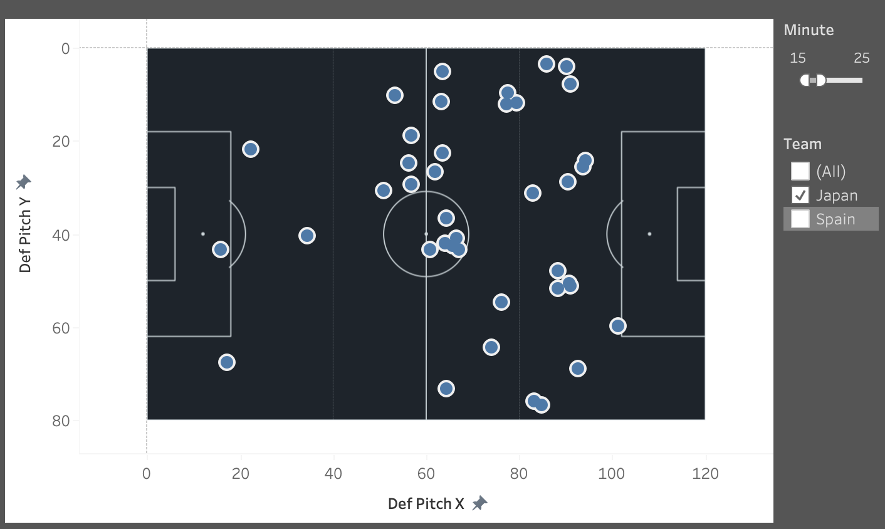
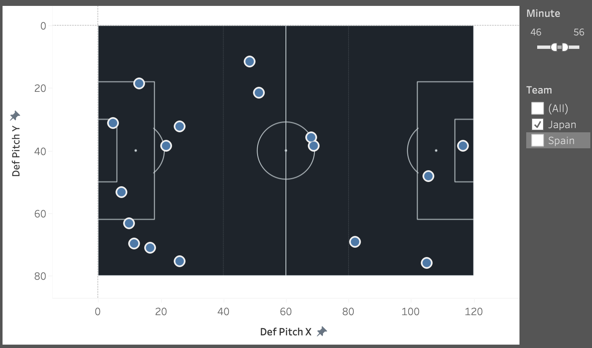
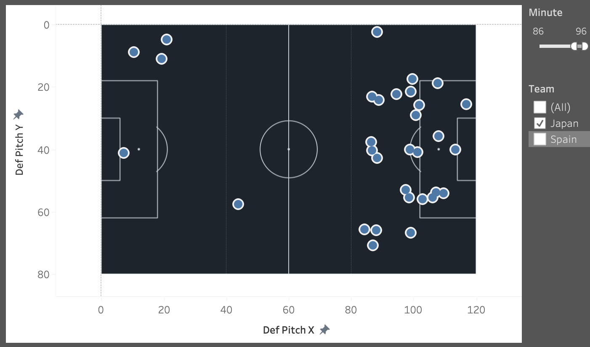

# 2022 FIFA World Cup: Japan vs. Spain Tactical Review 🇯🇵🇪🇸

An open-source football data science project analyzing the tactical dynamics, defensive shifts, and clinical finishing behind one of the most historic matches in the 2022 FIFA World Cup (Match ID: 3857256).

🔗 **Interactive Tableau Public Dashboard:** [View Live Dashboard](https://public.tableau.com/app/profile/taku.takahashi/viz/2022WorldCupJapanvs_SpainTacticalReview/2022FIFAWorldCupJapanvsSpainPost-MatchTacticalReview?publish=yes)

---

## 📊 Overview & Objectives
While much of the global media focused on the low possession metrics (~17.7%), this project dives deeper into the **spatial and temporal dynamics** of the match using **StatsBomb Open Data**, processed in **Python**, and visualized via **Tableau**. 

The goal was to move beyond final scores and scientifically unpack *how* and *when* the momentum shifted.

---

## 🛠️ Tech Stack
* **Data Extraction & Processing**: Python (Pandas, NumPy, StatsBomb API / Open Data libraries)
* **Visualization & Dashboarding**: Tableau Public (Custom Dark Theme / Qatar 2022 Aesthetic)
* **Version Control**: Git & GitHub

---

## 📐 Dashboard Structure & Key Insights

The dashboard is structured into three core analytical components:

### 1. Shot & xG Map (`Shot & xG Map`)
* **Focus**: Analyzing the efficiency and quality of chances.
* **Insight**: Despite minimal possession, the tactical transition and clinical execution allowed Japan to overperform their expected goals (xG) during critical moments.

### 2. Defensive Actions & Pressing Shift (`Defensive Actions`)
* **Focus**: Spatial distribution of defensive interventions (tackles, pressures, blocks).
* **Key Tactical Phases**:
  * **First Half**: Japan attempted to press, but Spain's exceptional technical quality bypassed initial pressure, resulting in scattered defensive actions and deep defending despite conceding only one goal.
  * **Second Half Start**: Japan turned up the intensity significantly, injecting fresh energy through substitutions and raising the defensive line's momentum.
  * **Final Phase (True Low Block)**: Spain heavily applied pressure seeking an equalizer, forcing Japan into a resolute, compact low block to secure the historic win.

| First Half | Second Half Start | Final Phase (Low Block) |
| :---: | :---: | :---: |
|  |  |  |

### 3. Resource Management & Substitutions (`Player Minutes & Substitutions`)
* **Focus**: Gantt chart tracking player minutes and substitution timing.
* **Insight**: Visualizes how fresh legs and tactical alterations directly correlated with the surge in defensive intensity and the shift in momentum.

---

## 🚀 How to Explore
1. Access the [Tableau Public Dashboard](https://public.tableau.com/app/profile/taku.takahashi/viz/2022WorldCupJapanvs_SpainTacticalReview/2022FIFAWorldCupJapanvsSpainPost-MatchTacticalReview?publish=yes).
2. Use the **Tactical Phase** and **Minute** filters on the right side to dynamically observe how defensive coordinates and pressure points evolve over the course of 90+ minutes.

---

## 👤 Author
**Taku Takahashi**
* Data Science Graduate Student (Universidad Carlos III de Madrid) | Former NCAA D1 Soccer Player
* [LinkedIn Profile](https://www.linkedin.com/) | [GitHub Repository](https://github.com/Taku30)
